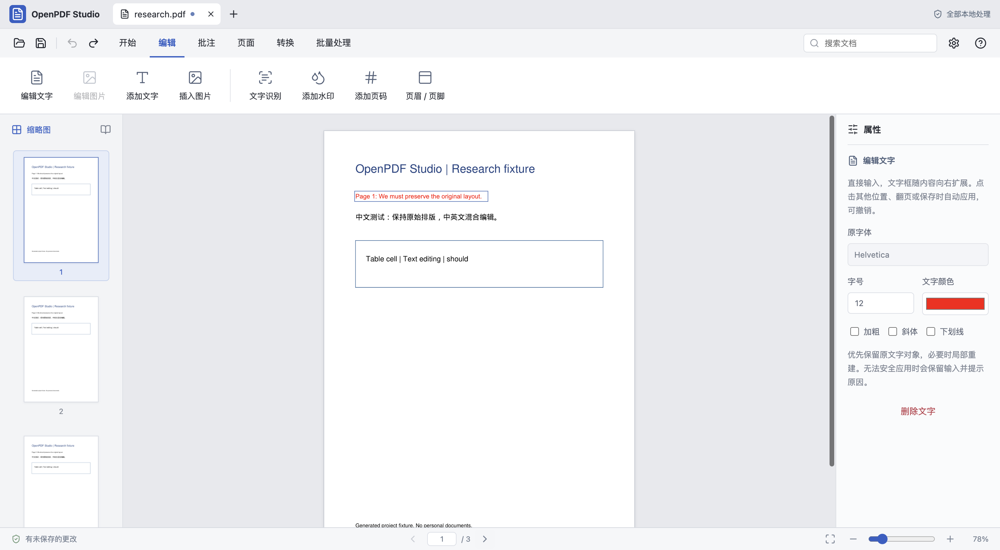

# OpenPDF Studio — Free, Open-Source PDF Editor

**WPS PDF interaction research, independently implemented for local editing on Windows x64 (preview) and Apple Silicon Macs.**

Edit PDF text and images, organize pages, run local Chinese/English OCR, export text-based Word documents, and batch-convert PDFs. No WPS subscription, account, or WPS AI service is required. Application menus switch instantly between Simplified Chinese and English; document content is not translated.

[中文](README.md) · [Website](https://aotefan.github.io/openpdf-studio/en/) · [Features and limits](docs/features.md) · [WPS PDF research](research/wps-pdf-reverse-engineering.md) · [Contribute](CONTRIBUTING.md)



## Release status

Version 0.2.0 adds Windows x64 launch paths, offline Chinese/English OCR, native Ctrl shortcuts and portable ZIP packaging. Native Windows Server 2025 CI passed 90 engine, 15 desktop and 28 bilingual UI tests, plus the relocated packaged-app smoke test. Windows 10/11 physical-device testing remains pending. [Download the portable preview](https://github.com/aotefan/openpdf-studio/actions/runs/42645629472/artifacts/13688640391) (GitHub sign-in required); see [Windows instructions and evidence](docs/windows.md) and [runtime security](docs/runtime-security.md). This preview is unsigned and has no installer or auto-updater.

## Features

|Task|Implementation|Limitations|
|---|---|---|
|Text editing|Click on-page text and type; replace/delete; position new text with the pointer|Safe horizontal spans; fallback fonts; no universal paragraph reflow|
|Image editing|Insert/replace/delete, drag/resize, rotate, opacity, central crop|Complex shared, nested or clipped placements can be rejected|
|Pages|Rotate, insert, delete, reorder, merge, split, extract, watermark and page numbers|500-page document limit|
|PDF to Word|DOCX text paragraphs|Not a lossless layout-preserving conversion|
|Other exports|XLSX tables/text rows, PPTX page images, PNG ZIP, TXT|PPTX output is raster page images|
|OCR|Windows offline models / macOS Apple Vision Chinese/English searchable text layers|No deskew or scan-image text replacement; mixed/rotated pages can be skipped|
|Batch operations|Multiple-file conversions; current-document text replacement and page-range OCR|Multiple-file OCR is not implemented|
|History|Undo/redo, save a copy, recover the last active document|Full rewrite rather than incremental saving|

Input limit: 60 MB and 500 pages per PDF. Encrypted, modification-restricted and signed files are rejected. This is an early research application, not a complete equivalent of every WPS PDF feature.

## Build from source

For Windows, follow [the native build instructions](docs/windows.md). macOS requirements: Apple Silicon, Xcode Command Line Tools, Python 3.12, uv, and a currently supported security-patched Node release. The reviewed LTS baseline is recorded in `.nvmrc`; recheck upstream security advisories before a new release.

```sh
git clone https://github.com/aotefan/openpdf-studio.git
cd openpdf-studio
uv venv --python 3.12 .venv
uv pip install --python .venv/bin/python -r requirements.txt
npm ci --ignore-scripts
mkdir -p build
swiftc src/ocr/vision.swift -o build/vision-ocr
npm run build
npm run test:engine
npm run test:desktop
```

Run `npm run check:runtime -- --electron` before installing or launching the Electron binary. Electron 45.2.3 now passes the metadata and actual-runtime checks. Install with `node node_modules/electron/install.js`, verify with `npm run check:runtime -- --electron --installed`, then use `npm start`.

## What “reverse-engineering WPS PDF” means here

REA was used for native UI observation and bounded read-only module analysis of WPS Office 12.1.28496. Ghidra was used for a targeted configuration-initialization function. The research informed interaction design; PDF processing is independently implemented with PyMuPDF. No WPS binaries, proprietary source, icons, membership bypasses or private services are included. WPS internal editing algorithms remain unverified.

OpenPDF Studio is not affiliated with WPS/Kingsoft or other similarly named OpenPDF libraries. See the [research summary](research/wps-pdf-reverse-engineering.md).

## Privacy and license

Documents are rendered, edited, recognized and converted locally. Dependency installation and runtime-version checks use the network without uploading PDFs.

Source: [AGPL-3.0-or-later](LICENSE). PyMuPDF/MuPDF uses its AGPL option. See [third-party notices](THIRD_PARTY_NOTICES.md), [contribution guidelines](CONTRIBUTING.md) and [security policy](SECURITY.md).
