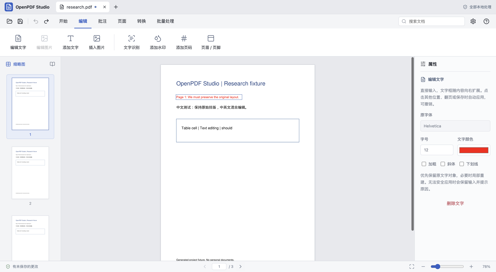

# OpenPDF Studio · 免费 PDF 编辑器

### 从逆向研究 WPS PDF，到独立开源的本地 PDF 工具

**修改 PDF 文字、编辑图片、PDF 转 Word、本地 OCR、批量转换——把常用 PDF 操作留在自己的 Mac 上。**

OpenPDF Studio 是面向 **macOS Apple Silicon** 的免费开源 PDF 编辑器。通过 REA 对 WPS PDF 的界面和部分模块做有边界的逆向研究，再用 React、Electron、PyMuPDF 和 Apple Vision 独立实现常用功能。中文界面优先，菜单可即时切换为 English；文档在本地处理，无会员登录和 WPS AI 依赖。

[English](README.en.md) · [项目主页](https://aotefan.github.io/openpdf-studio/) · [功能与限制](docs/features.md) · [WPS PDF 逆向研究笔记](research/wps-pdf-reverse-engineering.md) · [常见问题](docs/faq.md) · [参与贡献](CONTRIBUTING.md)



> **当前发布：0.1.14 源码预览。** 核心功能来自本机已测试的 0.1.13。此次公开源码、文档与测试；暂不提供安装包。2026-10-22 核查发现 Electron 内置 Node 尚低于最新安全补丁要求，桌面启动/打包设有版本检查。详见[运行时状态](docs/runtime-security.md)。

## 为什么做一个免费的 PDF 编辑器？

改几个字、替换一张图片、合并几页 PDF，应该有一个可以查看源码、自己运行的选择。OpenPDF Studio 的目标是提供熟悉的中文功能区和尽量少的确认步骤：点击正文定位，开始输入进入编辑，点击其他位置自动应用；可撤销的旋转、插入空白页和前后移动页面直接执行。

这里的“免费 PDF”指本项目源码和已实现功能不收取会员费用。开源许可为 **AGPL-3.0-or-later**，并不意味着所有 PDF 都能无损转换，也不意味着复制了 WPS 全部功能。

## 能做什么？

|你想做的事|当前实现|需要知道的边界|
|---|---|---|
|免费修改 PDF 文字|页面内定位、输入编辑、替换/删除、点击放置新文字；字号、颜色、下划线|以安全水平文字片段为主；字体可能替代；不支持任意段落重排|
|编辑 PDF 图片|插入、替换、删除、拖动、缩放、旋转、透明度、居中裁剪|共享、嵌套、复杂裁剪图片可能拒绝直接变换|
|合并、拆分、旋转 PDF|页面管理、多选、排序、提取、合并、拆分、页码、水印|最多 500 页；页面尺寸调整不等于重新排版|
|PDF 转 Word|导出 DOCX 文字段落|不是保留所有排版的无损转换|
|PDF 转 Excel / PPT / 图片|表格或文字行输出 XLSX；页面图片输出 PPTX；PNG ZIP|PPT 页面图片不能作为原生文字编辑|
|扫描 PDF 文字识别|Apple Vision 本地中英文 OCR，生成可搜索文字层|已有文字、旋转或混合页可能跳过；不替换扫描图像中的文字|
|批量处理 PDF|多文件转换、当前文档全文替换、页码/水印及页范围 OCR|多文件 OCR、任意图片批量替换尚未实现|
|撤销、重做、保存|编辑历史、另存副本、最近活动文档恢复|非增量保存；重启不恢复撤销栈|

输入限制为单份 PDF 60 MB、500 页。加密、限制修改或带签名的 PDF 会被拒绝。更多细节见[功能清单](docs/features.md)。

## 逆向 WPS PDF，具体研究了什么？

研究基准为 **WPS Office 12.1.28496 的 macOS 中文 PDF 界面**。使用 REA 记录界面状态、观察文字编辑流程，并对 Mach-O 模块、依赖、字符串和少量交叉引用做只读分析；曾用 Ghidra 定向查看配置初始化函数。

这些研究用于理解交互，而非拿到 WPS 源码。PDF 引擎由开源组件实现；没有绕过会员验证，没有复制 WPS 图标、二进制或专有实现。原始反编译输出和程序副本不随本仓库发布。项目与 WPS / 金山没有隶属或授权背书关系。

阅读：[逆向研究方法、证据等级和独立实现](research/wps-pdf-reverse-engineering.md)。

## 获取源码与构建

当前验证平台：macOS Apple Silicon。需要 Xcode Command Line Tools、Python 3.12、uv 和仍受支持且已修复已知漏洞的 Node.js。

```sh
git clone https://github.com/aotefan/openpdf-studio.git
cd openpdf-studio
# 安装/切换到 .nvmrc 指定的 Node LTS 补丁版，并核对最新官方安全公告。
uv venv --python 3.12 .venv
uv pip install --python .venv/bin/python -r requirements.txt
npm ci --ignore-scripts
mkdir -p build
swiftc src/ocr/vision.swift -o build/vision-ocr
npm run build
```

构建前端和测试引擎不需要运行 Electron。桌面启动前先运行：

```sh
npm run check:runtime -- --electron
# 仅在检查通过且 Electron 安全更新已完成回归后：
node node_modules/electron/install.js
npm start
```

当前锁定的 Electron 会被上述检查拦截，等待上游安全版本；不提供绕过检查的启动建议。[查看状态与后续升级步骤](docs/runtime-security.md)。

测试使用项目生成的 PDF，不需要 WPS 安装或会员：

```sh
npm run test:engine
npm run test:desktop
node --test tests/test_runtime_policy.cjs
# 安全运行时可用后执行真实 Electron 中英文 UI 回归：
npm run test:ui
```

## 中英文界面与隐私

- 设置 → 界面语言 → 简体中文 / English，无需重启；切换菜单语言不翻译 PDF 正文。
- 编辑、渲染、OCR 和转换在本机执行；应用不要求上传 PDF 或配置云端模型。
- 原 PDF 只读载入，编辑发生在副本中；保存时由用户选择目标路径。
- 网络仍用于源码下载、安装依赖及检查上游版本，这些步骤不发送用户 PDF。

## 常见问题

**这是免费 PDF 编辑器，还是 WPS 插件？** 独立的免费开源桌面应用，不依赖 WPS 运行；源码按 AGPL 提供。

**能作为 WPS PDF 免费替代吗？** 可以研究或使用已实现的常见编辑流程；不等同于 WPS PDF 的全部功能，也没有完整的表单、签名或复杂排版能力。

**为什么叫“逆向 WPS PDF”？** 研究的是正常界面行为与有边界的本地模块线索，产品代码独立编写。详情见研究笔记。

**支持 Windows、Intel Mac 或浏览器在线编辑吗？** 当前只验证 macOS Apple Silicon；网页是项目介绍，不是在线 PDF 上传工具。

**和 Java OpenPDF 库是同一个项目吗？** 不是。OpenPDF Studio 是此独立桌面编辑器项目，与其他同名 PDF 库没有隶属关系。

更多问题：[中文 FAQ](docs/faq.md) · [English README](README.en.md)。

## 参与与许可

欢迎提交可复现问题、脱敏测试文档、翻译和代码改进。优先方向：安全运行时升级、复杂字体保真、段落编辑、转换质量和大文件性能。请先看[贡献指南](CONTRIBUTING.md)和[安全策略](SECURITY.md)。

项目使用 [AGPL-3.0-or-later](LICENSE)，依赖 PyMuPDF/MuPDF 的 AGPL 版本。分发修改版本或提供网络服务时应遵守适用的源码提供义务。第三方许可见 [THIRD_PARTY_NOTICES.md](THIRD_PARTY_NOTICES.md)。
