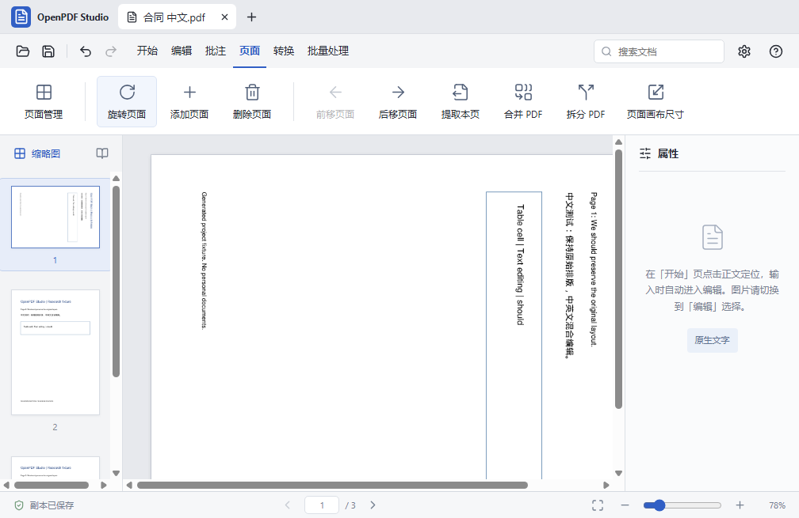
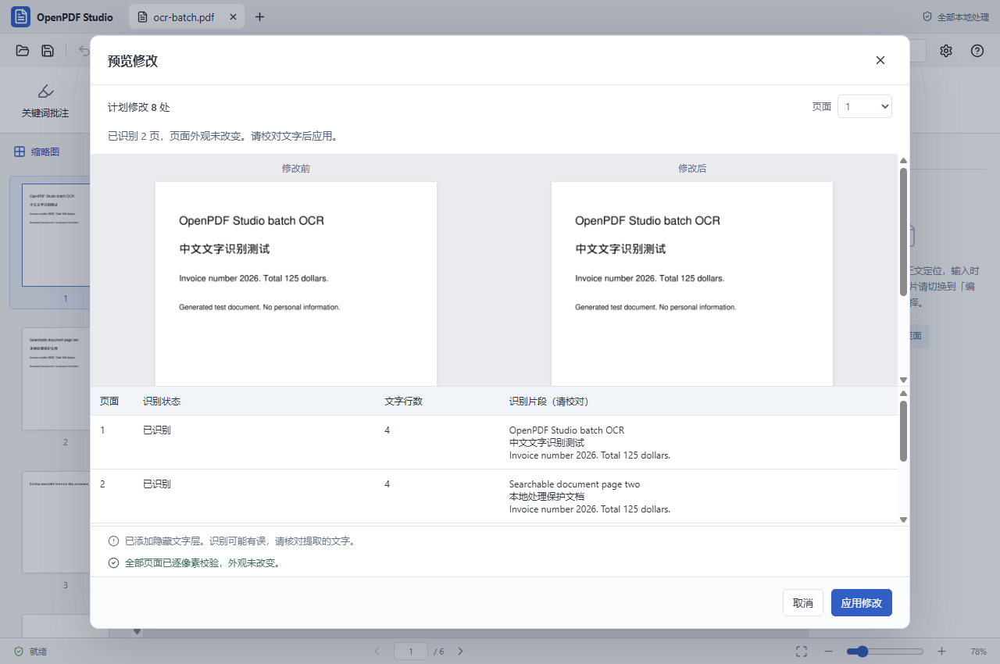

# Windows x64 便携预览

0.2.0 增加 Windows 10/11 x64 的启动、离线 OCR、原生菜单及便携 ZIP 构建路径。2026-11-09 已通过 Windows Server 2025 x64 原生 CI，生成并验收便携包。Windows 10/11 为兼容目标，实体机、高 DPI、多显示器和系统中文输入法的实际体验仍待验证。

0.2.1 新增 300 DPI 默认高清、600 DPI 超清图片导出，支持页码范围与批量清晰度设置；Windows 成品已独立回读验证 600 DPI 输出。[使用方法](image-export.md)。

## 使用已构建的便携版

**[下载 Windows x64 便携版 v0.2.2](https://github.com/aotefan/openpdf-studio/releases/download/v0.2.2/OpenPDF-Studio-0.2.2-windows-x64.zip)**。这是公开的 GitHub Release 附件，无需登录，也没有 Actions 构建产物的保存期限。完整解压 ZIP，运行 `OpenPDF Studio-win32-x64/OpenPDF Studio.exe`。保留旁边的 `resources`、DLL 和其他文件；不要只复制 EXE。已包含 Python 引擎、离线 OCR 模型及依赖，无需另外安装 Node、Python 或 Office。

这是未代码签名的便携预览，没有自动更新或文件关联。Windows 10/11 x64 为兼容目标；Windows ARM64 原生构建、32 位 Windows 和 Windows 7/8 不在支持范围内。

[发布说明](https://github.com/aotefan/openpdf-studio/releases/tag/v0.2.2) · [SHA256SUMS.txt](https://github.com/aotefan/openpdf-studio/releases/download/v0.2.2/SHA256SUMS.txt)。可用 PowerShell `Get-FileHash .\OpenPDF-Studio-0.2.2-windows-x64.zip -Algorithm SHA256` 与校验文件比较。0.2.2 更新 Pillow、pypdf 和 setuptools；历史版本的哈希与测试记录仅适用于各自版本。


## 从源码构建（PowerShell）

安装 x64 Node（`.nvmrc` 当前为 26.13.0 LTS）和 [uv](https://docs.astral.sh/uv/getting-started/installation/)。通过 uv 获取 Python 3.12.14，避免 Windows 官方安装器停留在 3.12.10。构建前重新核对 [Node 安全公告](https://nodejs.org/en/blog/vulnerability) 与 [Electron 版本](https://releases.electronjs.org/)。然后在项目目录执行：

```powershell
uv python install 3.12.14
uv venv --python 3.12.14 .venv
uv pip install --python .venv\Scripts\python.exe -r requirements-windows.lock
npm ci --ignore-scripts
node scripts/check-runtime.cjs --electron
node node_modules/electron/install.js
npm run check:runtime -- --electron --installed
npm run build
npm start
```

无需激活虚拟环境或调整 PowerShell 执行策略。Python、Node 和目标 Electron 必须都是 x64。`requirements-windows.lock` 固定 Windows 的完整 Python 依赖；更新输入要求后用 `uv pip compile requirements-windows.txt --python-platform windows --python-version 3.12 --no-header --output-file requirements-windows.lock` 重新生成。

```powershell
npm run test:desktop
npm run test:engine
npm run test:ui
npm run package:win
npm run test:packaged
```

`package:win` 自动检查已安装的运行时，编译前端，用 PyInstaller 打包本机 Python 引擎，收集 OCR 模型和本地库，生成图标及便携 ZIP。输出在 `release/artifacts.noindex/0.2.2/`。不支持从 Mac 把 macOS 引擎拷进 Windows 安装目录；脚本会直接拒绝这种跨系统构建。

## Windows 行为

- `Ctrl+O` 打开，`Ctrl+S` 另存副本，`Ctrl+Z` 撤销，`Ctrl+Y` 重做，`Ctrl+F` 搜索。也保留 `Ctrl+Shift+Z` 重做。菜单、工具提示及帮助与平台一致。
- Python 开发路径为 `.venv\Scripts\python.exe`，发布路径为 `resources\engine\openpdf-engine.exe`；后台进程隐藏控制台。
- Python 通信固定 UTF-8，支持中文、空格用户名和文件路径。退出/启动失败会拒绝未完成的请求并显示错误。
- Windows OCR 使用 RapidOCR / ONNX Runtime CPU 和随包附带的 PP-OCR 中英文模型；macOS 继续使用 Apple Vision。两者识别结果可能不同。
- OCR 只添加隐藏搜索文字层，提交前仍执行逐像素核验。混合文字页、旋转页等原有限制不变。单页超时为 120 秒；取消会等待当前页结束后丢弃临时结果。
- 便携包从移动后的中文空格目录启动；测试覆盖原生保存、保存重开、离线 OCR、Office 导出、运行时真实版本及页面错误。

## 自动验收

`.github/workflows/windows.yml` 在 Windows runner 上安装锁定依赖，执行引擎、桌面逻辑、中英文 UI、打包和迁移目录后的便携包测试。只有全部成功才上传 ZIP；失败保留测试证据。可在 GitHub Actions 手动运行 `Windows x64 preview`，或由 PR / main 推送触发。

0.2.1 已验收的源码提交为 `1182711ac8435a6bb535cde651106fa0b1c73497`，对应 [Windows 原生作业](https://github.com/aotefan/openpdf-studio/actions/runs/42735733204)。后续文档提交不改变该便携包；不要把其他提交的源码测试结果当作此二进制的证据。

## 0.2.1 高清导出验证（2026-11-09，美东时间）

[Windows 原生 CI](https://github.com/aotefan/openpdf-studio/actions/runs/42735733204) 全部通过：109 项引擎、16 项桌面、30 项中英文 UI 测试。成品从中文空格目录启动，保存重开、离线 OCR 和五种转换均通过；从包内引擎导出的 600 DPI PNG 经 Pillow 独立读取，像素尺寸为 4959 × 7017，DPI 为 600 × 600。实际运行时仍为 Node 26.13.0、Electron 45.2.3 / 内置 Node 24.22.2、Python 3.12.14。

下载后校验 ZIP CRC、主程序和引擎 x64 PE、Python 版本、三个 OCR 模型、随包 0.2.1 源码和 SHA-256。[完整截图及测试证据](https://github.com/aotefan/openpdf-studio/actions/runs/42735733204/artifacts/13726902328)。macOS arm64 的 0.2.1 成品也通过迁移目录后的保存、OCR、转换及 600 DPI 图片回读。


## 0.2.0 Windows 原生验证记录（历史）

环境：Windows Server 2025 x64 / 10.0.26100，Node 26.13.0，Electron 45.2.3（内置 Node 24.22.2、Chromium 156.0.8078.80），Python 3.12.14。Python 来自 uv 管理的独立构建，构建日志与包内 `resources/engine/build-info.json` 保留实际版本。

|检查|结果|
|---|---|
|引擎测试|90 项通过，含 RapidOCR 中英文、保存重开及像素完整性|
|桌面逻辑|15 项通过|
|中英文 UI|28 项通过；覆盖 1496×855、1280×850、980×640 窗口|
|原生打包|PyInstaller worker、Electron x64、OCR 模型和便携 ZIP 构建成功|
|迁移后的成品|复制到中文空格临时目录，以成品 EXE 启动，`app.isPackaged = true`|
|保存重开|Ctrl+S 保存中文文件名，重开后 3 页、首页旋转 90°符合预期|
|离线 OCR|设置不可用的 HTTP/HTTPS 代理后，包内模型识别中文和英文，渲染差异为空|
|导出|成品引擎生成 DOCX、XLSX、PPTX、PNG ZIP、TXT|
|界面健康|页面身份、文档渲染、无框架错误层、控制台无错误|

真实截图与文件证据见 [Windows 测试产物](https://github.com/aotefan/openpdf-studio/actions/runs/42645629472/artifacts/13688910058)。使用仓库 Playwright 驱动 Windows Electron（Browser plugin not available）；原生文件对话框通过测试替身提供路径，系统对话框交互本身未作人工验收。系统输入法、杀毒软件、代码签名和安装器不在本轮覆盖范围内。

首轮有两项独立 PDF 回读测试因 pypdf 的 CMap 特殊码点不能直接写入严格 UTF-8 管道而失败。原始样本及保存文件的内容检查正常；现改用 ASCII JSON 传输并还原完整字符串，保留原断言，重跑全部 Windows 测试通过。





## 2026-11-09 本地验证记录

开发主机为 macOS arm64，实际使用 Node 26.13.0、Electron 45.2.3 / 内置 Node 24.22.2、Python 3.12.14。

|检查|结果|范围|
|---|---|---|
|引擎测试|90 项通过|整套测试切换到 Windows 所用的 RapidOCR 后端，在 macOS 执行|
|桌面逻辑|15 项通过|Windows 路径、中文通信、子进程失败处理、批量转换、运行时规则|
|中英文 UI|28 项通过|打开、编辑、保存、撤销重做、OCR、转换；macOS Electron 实际界面|
|离线模型冻结|通过|PyInstaller 冻结 RapidOCR 后，在独立目录执行子进程 OCR、中文搜索和保存重开；像素不变|
|应用迁移目录|通过|macOS 成品移入中文空格目录，保存重开、OCR、DOCX/XLSX/PPTX/PNG/TXT 导出及真实运行时检查|
|Windows x64 wheels|47 个包解析、下载及安装到隔离目标目录成功|仅依赖可获得性检查，没有执行 Windows DLL|
|npm audit|0 项已知漏洞|执行时依赖树审计|
|Windows 原生构建与 UI|远端通过|见上方 Windows 原生记录；非 macOS 模拟结果|

界面验证使用仓库 Playwright（Browser plugin not available），覆盖 1496×855、1280×850、980×640 的桌面窗口；这是桌面应用，没有移动端支持目标。页面身份、非空白、无框架错误层、控制台及实际交互均通过相关测试。首次回归发现表格库提示污染 JSON 通信，现已将库诊断转到 stderr，并增加通信回归测试。
